# Diagrama Entidade-Relacionamento (ER)

Este diagrama foi elaborado com base nas migrations existentes no repositório. As tabelas técnicas do Laravel também estão incluídas.

```mermaid
erDiagram
    CLIENTES {
        unsignedBigInteger CLICODIGO PK
        string_150 CLINOME
        string_15 CLICPF UK
        string_20_nullable CLITELEFONE
        string_150_nullable CLIEMAIL
        date CLIDTNASC
        date CLIDTCAD
    }

    AUTORES {
        unsignedBigInteger AUTCODIGO PK
        string_150 AUTNOME
        string_150_nullable AUTPSEUDONIMO
        text_nullable AUTBIOGRAFIA
        string_100_nullable AUTPAISNASC
    }

    LIVROS {
        unsignedBigInteger LVRCODIGO PK
        string_150 LVRTITULO
        string_15_nullable_unique LVRISBN
        integer_nullable LVREDICAO
        date_nullable LVRDTPUBLIC
        text_nullable LVRSINOPSE
        integer_nullable LVRFAIXAETARIA
    }

    NIVEIS {
        unsignedBigInteger NVLCODIGO PK
        string_30 NVLNOME UK
    }

    GENEROS {
        unsignedBigInteger GNRCODIGO PK
        string_30 GNRNOME UK
    }

    USUARIOS {
        unsignedBigInteger USRCODIGO PK
        string_150 USRNOME
        string_15 USRCPF UK
        string_20 USRLOGIN UK
        string_255 USRSENHA
        unsignedBigInteger USRNIVEL FK
        string_150 USREMAIL UK
        date USRDTCAD
    }

    EMPRESTIMOS {
        unsignedInteger EMPCODIGO PK
        unsignedInteger EMPLIVRO FK
        unsignedInteger EMPUSUARIO FK
        unsignedInteger EMPCLIENTE FK
        date EMPDTEMPR
        date_nullable EMPDTDEVOL
    }

    CLASSIFICACAO {
        unsignedBigInteger CLSLIVRO PK, FK
        unsignedBigInteger CLSGENERO PK, FK
        boolean CLSPRINCIPAL
    }

    AUTORIA {
        unsignedBigInteger ATRLIVRO PK, FK
        unsignedBigInteger ATRAUTOR PK, FK
        boolean_nullable ATRPRINCIPAL
    }

    EXEMPLARES {
        unsignedBigInteger EXMCODIGO PK
        unsignedBigInteger EXMLIVRO FK
        date_nullable EXMDTAQUISICAO
        boolean EXMDISPONIVEL
    }

    AUDITORIAS {
        unsignedBigInteger AUDCODIGO PK
        unsignedBigInteger_nullable AUDUSUARIO
        string_10 AUDACAO
        string_60 AUDTABELA
        unsignedBigInteger AUDREGISTRO
        json_nullable AUDANTES
        json_nullable AUDDEPOIS
        timestamp AUDDATA
    }

    users {
        unsignedBigInteger id PK
        string name
        string email UK
        timestamp_nullable email_verified_at
        string password
        string_nullable remember_token
        timestamps created_at_updated_at
    }

    password_reset_tokens {
        string email PK
        string token
        timestamp_nullable created_at
    }

    sessions {
        string id PK
        unsignedBigInteger_nullable user_id
        string_45_nullable ip_address
        text_nullable user_agent
        longText payload
        integer last_activity
    }

    cache {
        string key PK
        mediumText value
        integer expiration
    }

    cache_locks {
        string key PK
        string owner
        integer expiration
    }

    jobs {
        unsignedBigInteger id PK
        string queue
        longText payload
        unsignedTinyInteger attempts
        unsignedInteger_nullable reserved_at
        unsignedInteger available_at
        unsignedInteger created_at
    }

    job_batches {
        string id PK
        string name
        integer total_jobs
        integer pending_jobs
        integer failed_jobs
        longText failed_job_ids
        mediumText_nullable options
        integer_nullable cancelled_at
        integer created_at
        integer_nullable finished_at
    }

    failed_jobs {
        unsignedBigInteger id PK
        string uuid UK
        text connection
        text queue
        longText payload
        longText exception
        timestamp failed_at
    }

    NIVEIS ||--o{ USUARIOS : possui
    LIVROS ||--o{ EMPRESTIMOS : referencia
    USUARIOS ||--o{ EMPRESTIMOS : realiza
    CLIENTES ||--o{ EMPRESTIMOS : recebe

    LIVROS ||--o{ CLASSIFICACAO : possui
    GENEROS ||--o{ CLASSIFICACAO : classifica

    LIVROS ||--o{ AUTORIA : possui
    AUTORES ||--o{ AUTORIA : participa

    LIVROS ||--o{ EXEMPLARES : possui
```

## Observações importantes

- `AUTORIA` e `CLASSIFICACAO` são tabelas associativas com chaves primárias compostas.
- `AUDITORIAS.AUDUSUARIO` possui índice, mas a migration não declara uma chave estrangeira para `USUARIOS`.
- `sessions.user_id` também não possui uma chave estrangeira declarada na migration.
- As tabelas `users`, `password_reset_tokens`, `sessions`, `cache`, `cache_locks`, `jobs`, `job_batches` e `failed_jobs` são tabelas técnicas criadas pelas migrations do Laravel.
- Em `EMPRESTIMOS`, as colunas de referência são declaradas como `unsignedInteger`, enquanto os identificadores de `LIVROS`, `USUARIOS` e `CLIENTES` são criados com `id()`, que usa `unsignedBigInteger`. Essa diferença merece validação no banco de dados, especialmente no MySQL.
- Os sufixos `_nullable`, `_unique` e os marcadores `PK`, `FK` e `UK` indicam, respectivamente, campos anuláveis, restrições de unicidade e tipos de chave. Os nomes e tipos devem ser conferidos nas migrations se elas forem alteradas.